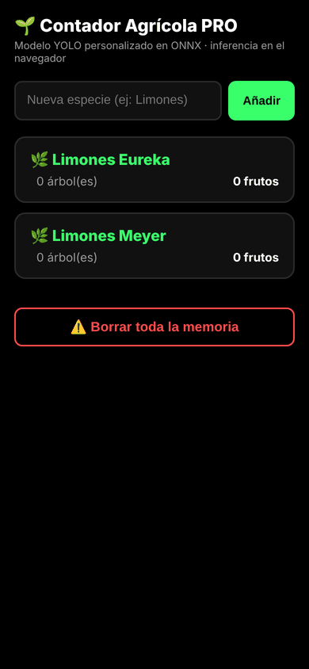

# Contador Agrícola PRO — detección de limones

> **EN:** Counts lemons live from a phone camera with a custom YOLO model exported to ONNX and run entirely in the browser (ONNX Runtime Web). Counts accumulate per tree and species. **[Live demo](https://luminous-bubblegum-27933a.netlify.app/)**.

Aplicación web para cámara y conteo acumulativo por árbol mediante un modelo YOLO convertido a ONNX. La inferencia se ejecuta en el navegador con ONNX Runtime Web y el conteo se guarda en `localStorage` del dispositivo.

## Modelo

`best.onnx` es un modelo **YOLO11s** entrenado por el autor con un conjunto de imágenes de limones (una clase, `lemon`), exportado a ONNX con Ultralytics el 26 de agosto de 2026. Entrada `[1, 3, 640, 640]`, salida `[1, 5, 8400]`; pesa 38 MB. El modelo también está cubierto por la licencia de este repositorio.

## Ejecución

Sirve la carpeta por HTTPS o `localhost`; los navegadores normalmente no permiten acceso a cámara desde un sitio HTTP no seguro. La aplicación solicita cámara y procesa los fotogramas en el cliente. Los registros de especies, árboles y cantidades quedan en el almacenamiento local del navegador y no se sincronizan automáticamente.

## Dependencias y límites

- ONNX Runtime Web se descarga desde jsDelivr; el código configura sus archivos WASM desde esa CDN.
- No se detectaron claves de API, contraseñas ni tokens en el HTML proporcionado.
- El postprocesamiento está escrito para una salida YOLO concreta (`[1,5,8400]`). Debe validarse contra el modelo real antes de presentar el conteo como fiable.
- El sistema acumula tracks mediante proximidad de centroides; en paneos reales puede contar frutos dos veces o perder detecciones. Debe validarse experimentalmente con datos de campo.

## Historial de versiones

La rama [`historial`](https://github.com/vicentebohlealveal/contador-agricola-yolo/tree/historial) reconstruye, commit por commit, cómo evolucionó el programa a partir de las versiones que quedaron guardadas. El resumen está en [`VERSIONES.md`](https://github.com/vicentebohlealveal/contador-agricola-yolo/blob/historial/VERSIONES.md).

## Licencia / License

© 2026 Vicente Bohle Alveal. Todos los derechos reservados / All rights reserved. Público solo para revisión como portafolio; ver [LICENSE](LICENSE).

Parte del [portafolio de Vicente Bohle Alveal](https://github.com/vicentebohlealveal/vicente-bohle-software-portfolio).
